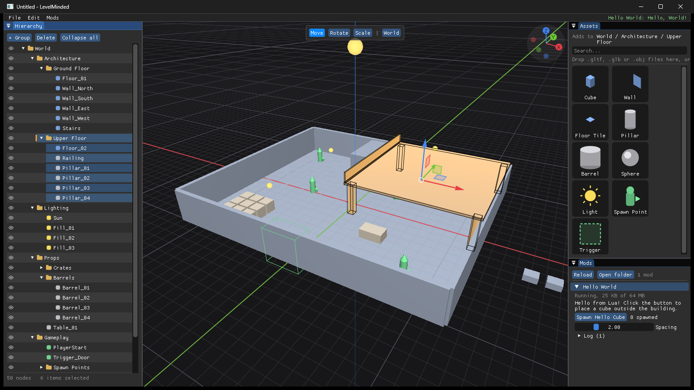
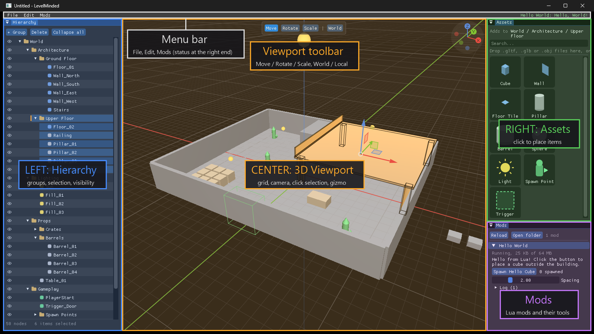
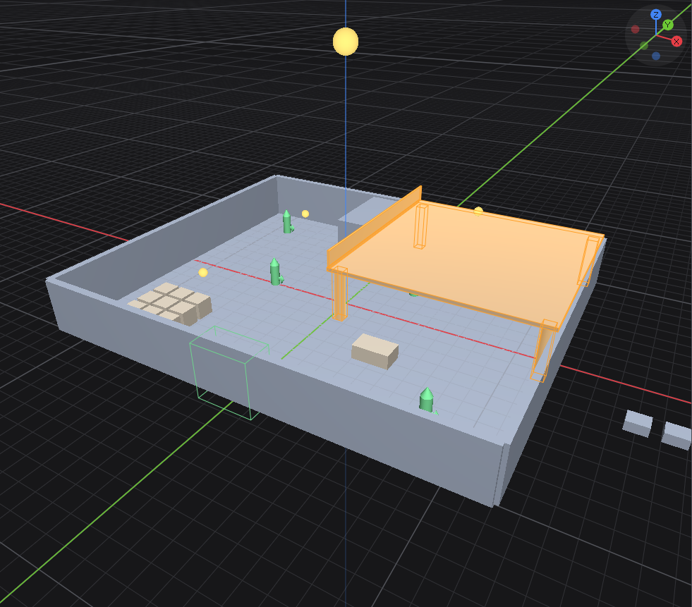
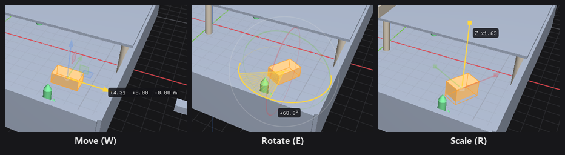
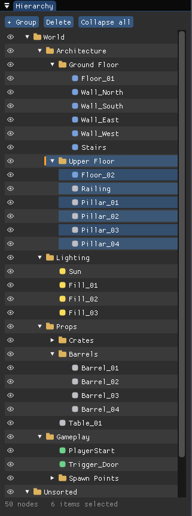
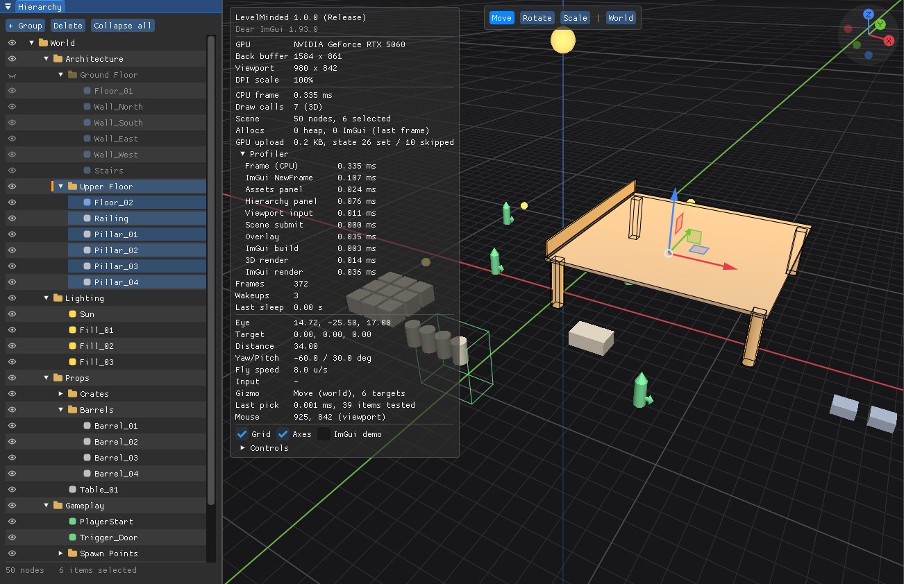
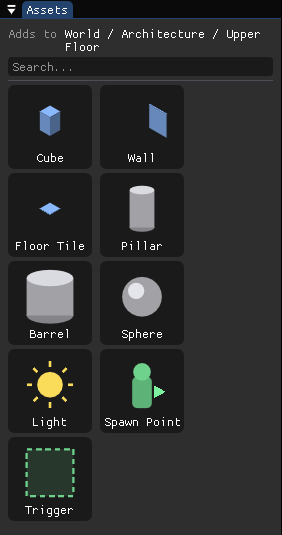
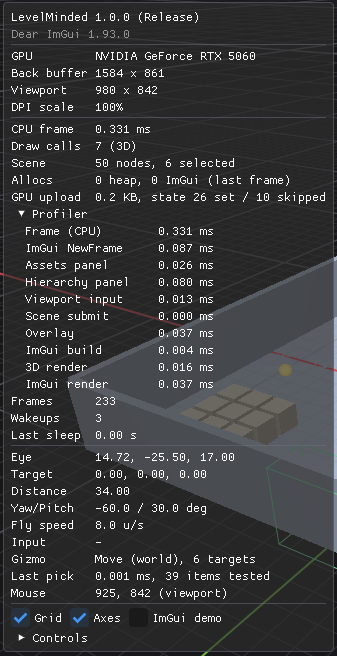

# LevelMinded

**LevelMinded is a lightweight, extremely optimized 3D map design tool for Windows.** It gives level designers a fast 3D viewport, a group-based hierarchy for organizing a map, and a palette of placeable items, in a single portable executable of about 1.5 MB that uses almost no CPU while you are not interacting with it.



> **Status:** v1.0 is the first public release, focused on the core editor: viewport, hierarchy and asset palette. Click selection, move / rotate / scale tools, model importing (glTF and OBJ) and saving / loading maps are now on `main`. Mod support is next (see [Roadmap](#roadmap)).

## Contents

- [Highlights](#highlights)
- [Getting Started](#getting-started)
- [Interface Overview](#interface-overview)
- [Center: 3D Viewport](#center-3d-viewport)
- [Left Panel: Hierarchy](#left-panel-hierarchy)
- [Right Panel: Assets](#right-panel-assets)
- [Saving and Loading Maps](#saving-and-loading-maps)
- [Stats Overlay](#stats-overlay)
- [Performance](#performance)
- [Known Limitations](#known-limitations)
- [Roadmap](#roadmap)
- [Building from Source](#building-from-source)
- [Third-Party Software](#third-party-software)
- [License](#license)

## Highlights

- **Portable:** one `.exe`, no installer, no runtime to install, no files written to your system.
- **Instant and idle-friendly:** the window opens in about a quarter of a second, and the editor only draws frames while something is changing, so it uses close to 0% CPU when idle.
- **Infinite grid and editor camera:** orbit, pan, zoom and fly controls familiar from other 3D tools.
- **Click to select, drag to transform:** click any item in the 3D view to select it, then move, rotate or scale it with an on-screen gizmo (W / E / R), with optional snapping.
- **Group hierarchy:** nest items in groups, select a whole group with one click, hide and show entire groups, and reorganize everything with drag and drop.
- **Asset palette:** click an item to place it straight into the group you are working in.
- **Save and load maps:** readable JSON map files that bring back every group, item, transform, visibility setting and imported model exactly as you left them.
- **Bring your own models:** drag `.gltf`, `.glb` or `.obj` files onto the window (or use **File > Import Asset**) and they join the palette, at their real size and orientation.
- **Built to scale:** stays smooth with 100,000+ items in a map.

## Getting Started

### Requirements

- Windows 10 or Windows 11 (64-bit)
- A graphics card with Direct3D 11 support (any GPU from the last decade)
- Any 64-bit x86 CPU

### Download and run

1. Open the [Releases page](https://github.com/KurosaCorp/Level-Minded-V2/releases) and download `LevelMinded_v1.0.zip`.
2. Extract the zip to any folder (for example your Desktop or `C:\Tools\LevelMinded`).
3. Double-click **`LevelMinded.exe`**.

There is nothing to install. The folder contains only:

| File | Purpose |
|---|---|
| `LevelMinded.exe` | The application |
| `README.txt` | Short quick-start and control reference |
| `THIRD_PARTY_LICENSE_DearImGui.txt` | License of the Dear ImGui library used for the interface |
| `THIRD_PARTY_LICENSE_cgltf.txt` | License of the cgltf library used to read glTF models |
| `THIRD_PARTY_LICENSE_fast_obj.txt` | License of the fast_obj library used to read OBJ models |
| `THIRD_PARTY_LICENSE_simdjson.txt` | License of the simdjson library used to read map files |

To remove LevelMinded, delete the folder. It does not write settings, registry entries or files anywhere else.

> **"Windows protected your PC"?** The executable is not code-signed yet, so Windows SmartScreen may warn the first time you run it. Click **More info**, then **Run anyway**. Your antivirus may also scan the new file once, which can make the very first launch a little slower.

### First launch

LevelMinded opens with a small **sample level**: a two-storey building with props, lights and gameplay markers. It lets you try every feature right away:

- the **Hierarchy** on the left,
- the **3D Viewport** in the center,
- the **Assets** palette on the right.

## Interface Overview



| Area | What it is for |
|---|---|
| **Left: Hierarchy** | The structure of your map: groups and the items inside them. Select, hide, rename, reorder and regroup. |
| **Center: 3D Viewport** | The map in 3D, with an infinite ground grid and a free editor camera. |
| **Right: Assets** | A palette of items you can place into the map. |

The panels are docked and can be resized by dragging the borders between them.

## Center: 3D Viewport



The viewport shows the map in 3D on top of an **infinite ground grid**.

- **World axes:** the world is **Z-up**, measured in **meters**. The X axis is drawn in **red**, Y in **green** and Z (vertical) in **blue**.
- **Grid:** the finest grid cells are 1 m. As you zoom out, the grid switches to 10 m and then 100 m cells and fades toward the horizon, so it stays readable at any distance.
- **Orientation gizmo:** the axis gizmo in the top-right corner always shows which way X, Y and Z point.
- **Items:** brushes, meshes, lights and entities are drawn as solid, shaded shapes. Lights glow. Volumes such as triggers are drawn as green wireframe boxes.
- **Selection:** click an item to select it. Selected items are tinted orange and outlined. The outline stays visible through walls, so you never lose track of what you selected.

### Camera controls

| Input | Action |
|---|---|
| **Alt + Left mouse drag** | Orbit around the focus point |
| **Middle mouse drag** | Pan |
| **Alt + Right mouse drag** | Zoom (drag right or up to move closer) |
| **Mouse wheel** | Zoom |
| **Right mouse drag** | Fly mode: look around from the camera's position |
| **Right mouse + W / A / S / D** | Fly forward / left / back / right |
| **Right mouse + Q / E** | Fly down / up |
| **Shift / Ctrl** (while flying) | Fly 4× faster / 4× slower |
| **Mouse wheel** (while flying) | Change fly speed |
| **F** | Frame the selection: center the camera on it and zoom to fit (world origin if nothing is selected) |
| **Home** | Reset the camera to the default view |
| **Numpad 1 / 3 / 7** | Front / right / top view |
| **Ctrl + Numpad 1 / 3 / 7** | Back / left / bottom view |

Keyboard shortcuts apply when the viewport has focus. If you have just clicked a panel, click anywhere in the viewport first.

### Selecting and transforming items



**Click** an item in the viewport to select it. The Hierarchy scrolls to it, highlights it and makes it the active node, so the item's group becomes the active group. Clicking where there is no item clears the selection. Hidden items cannot be clicked. Volumes such as triggers can be clicked on their box, but a solid item inside or behind a volume is picked first.

The **transform gizmo** appears on the selection. When several items are selected (for example a whole group), it sits at their center and transforms all of them together. The toolbar at the top of the viewport switches between the three tools:

| Tool | Key | Handles |
|---|---|---|
| **Move** | **W** | Drag an **arrow** to move along one axis, a **square** to move in that plane, or the **center circle** to move parallel to the screen. |
| **Rotate** | **E** | Drag a **ring** to rotate around that axis, or the **outer ring** to rotate around the viewing direction. |
| **Scale** | **R** | Drag an **axis box** to stretch along that axis, or the **center box** to scale evenly. |

| Input | Action |
|---|---|
| **Left click** | Select the item under the cursor (empty space clears the selection) |
| **Ctrl + left click** | Add the item to the selection, or remove it |
| **Shift + left click** | Add the item to the selection |
| **Left drag on a handle** | Move, rotate or scale the selection |
| **Ctrl** (while dragging) | Snap: 0.25 m steps, 15° steps, 0.1× steps |
| **Esc** (while dragging) | Cancel the drag and put everything back |
| **W / E / R** | Move / rotate / scale tool |
| **X**, or the **World / Local** button | Gizmo axes: world axes, or the selected item's own axes |

The handle you hover turns yellow, and while dragging, the exact offset, angle or scale factor is shown next to the cursor. Scaling a single item always uses the item's own axes, so a rotated item stretches along its own length rather than skewing.

## Left Panel: Hierarchy



The Hierarchy shows every **group** and **item** in the map as a tree. Each row has:

- an **eye icon** on the left (visibility),
- an **expand arrow** for groups,
- an **icon** for the node type:
  - **folder:** group
  - **blue square:** brush
  - **gray square:** mesh
  - **yellow square:** light
  - **green square:** entity
- the **name**.

The toolbar at the top has **+ Group**, **Delete** and **Collapse all**. The footer shows how many nodes the map contains and how many items are selected.

### Groups and mass selection

- **Click a group** to select the group **and everything inside it**, including nested groups. This is the fastest way to select a whole area or category of a map at once.
- **Click an item** to select just that item.
- **Ctrl + click** adds a node, with everything inside it, to the selection, or removes it.
- Removing an item from a selected group also unmarks the group itself, because the group is then no longer fully selected.
- **Click empty space** in the panel to clear the selection.

Selected items are highlighted both in the Hierarchy and in the 3D viewport.

### Visibility



- Click the **eye icon** to hide or show a node.
- **Hiding a group hides everything inside it.** Its contents are dimmed in the Hierarchy and disappear from the viewport.
- Each item keeps its own visibility setting. When you show a group again, items you had hidden individually stay hidden.
- Hover over an eye icon to see whether a node is hidden by its own setting or by a parent group.

### Organizing with drag and drop

Drag any row and drop it onto another row:

| Drop position | Result |
|---|---|
| **Top edge** of a row | Place it **before** that row |
| **Bottom edge** of a row | Place it **after** that row |
| **Middle** of a group | Move it **into** that group (as the last child) |
| **Bottom edge** of an open group | Move it into that group as its **first** child |

A line (before or after) or a frame (into) shows where the node will land. Dragging a group moves it together with all of its contents. A group cannot be dropped into itself.

### Creating, renaming and deleting

| Action | How |
|---|---|
| **New group** | Click **+ Group**. The group is created inside the active group (or next to the active item) and its name is ready to type. Press **Enter** to confirm. |
| **Rename** | **Double-click** a name, or select it and press **F2**. **Enter** confirms, **Esc** cancels. |
| **Delete** | Select nodes and press **Delete** or click the **Delete** button. Deleting a group deletes its contents. |
| **Collapse all** | Folds every group so only the top level is visible. |

### The active group

The **active group** is where new content goes:

- it is the group you last clicked,
- or the parent group of the item you last clicked (in the Hierarchy or in the viewport),
- or the top level, if nothing is active.

It is marked with an **orange bar** on the left of its row, and the Assets panel shows it at the top. To place items somewhere else, click the group you want first.

## Right Panel: Assets



The Assets panel is a palette of items you can add to the map.

1. Pick the target group in the Hierarchy. The panel shows it under **"Adds to"**, for example `World / Props`.
2. **Click a tile.** The item is placed at the **world origin**, standing on the ground with the center of its base at (0, 0, 0).
3. The new item appears in the Hierarchy inside the active group, gets a numbered name (`Cube_01`, `Cube_02`, ...), and is selected, ready to work with. Clicking more tiles keeps adding to the same group.

Use the **search box** to filter the palette by name. Hover over a tile to see its type and size.

| Item | Type | Size (m) | Notes |
|---|---|---|---|
| **Cube** | Brush | 1 × 1 × 1 | Basic building block |
| **Wall** | Brush | 4 × 0.2 × 3 | |
| **Floor Tile** | Brush | 4 × 4 × 0.1 | |
| **Pillar** | Mesh | 0.6 × 0.6 × 3 | Round column |
| **Barrel** | Mesh | 0.8 × 0.8 × 1.2 | Prop |
| **Sphere** | Mesh | 1 × 1 × 1 | Prop |
| **Light** | Light | 0.5 × 0.5 × 0.5 | Point light, drawn glowing |
| **Spawn Point** | Entity | 0.8 × 0.8 × 1.8 | Player spawn; the arrow shows the facing direction (+X) |
| **Trigger** | Entity | 2 × 2 × 2 | Trigger volume, drawn as a wireframe box |

If the active group is hidden, newly placed items start hidden too, because they follow their group's visibility.

### Importing your own models

Add your own 3D models to the palette in either of two ways:

- **Drag and drop** one or more `.gltf`, `.glb` or `.obj` files from File Explorer onto the LevelMinded window.
- **File > Import Asset...** (**Ctrl + I**) and pick the files.

Each model gets its own tile, marked with a **glTF** or **OBJ** badge and highlighted until your next click. A line under the search box reports the result, for example *"Imported Chair: 12,345 triangles in 4.2 ms"*, or explains what went wrong. Imported tiles work like the built-in ones: click to place the model at the origin in the active group, then click it in the viewport to select it and move, rotate or scale it.

| Format | Supported |
|---|---|
| **glTF 2.0** (`.gltf` with embedded or separate `.bin` buffers, binary `.glb`) | All triangle meshes of the default scene, with their node transforms (position, rotation, scale, parent/child hierarchy). Material base colors and vertex colors. Double-sided materials. |
| **Wavefront OBJ** (`.obj`, with its `.mtl` file) | Polygons of any size (split into triangles), normals, material diffuse colors (`Kd`). Missing normals are calculated (smooth). |

How models are placed:

- **Real size and orientation.** 1 unit in the file is 1 meter. Models are converted from the Y-up convention of glTF and most OBJ exporters to LevelMinded's Z-up world, so they stand upright. A model placed with scale 1 has exactly its authored size, and its gizmo pivot is the center of its bounding box. Spawned models rest on the ground with their base at the origin.
- **One mesh per file.** All parts of a model are merged into a single mesh, so it is placed, selected and transformed as one item.
- **Importing the same file twice** just highlights the existing tile. A different file with the same name gets a numbered name (`Chair (2)`).

## Saving and Loading Maps

Maps are saved as `.lmmap` files from the **File** menu:

| Command | Shortcut | What it does |
|---|---|---|
| **Load...** | **Ctrl + O** | Opens a map. The current map is replaced completely. |
| **Save** | **Ctrl + S** | Saves to the current file (the first save of a new map asks for a name). |
| **Save As...** | **Ctrl + Shift + S** | Saves under a new name. |

- **What is saved:** every group and item with its position in the hierarchy, its name, position, rotation, scale and size, which built-in shape or imported model it shows, its visibility, which groups are expanded, the imported models in the palette, and the camera view. The selection is not saved.
- **Exact:** loading a map brings everything back exactly as it was saved, down to the last bit of every number, in both the 3D viewport and the Hierarchy.
- **Unsaved changes:** the title bar shows the map name with a `*` when it has unsaved changes. Loading another map or closing LevelMinded asks first whether to save them.
- **Safe saving:** a map is written to a temporary file first and then swapped in, so a failed save never damages the previous version.
- **Safe loading:** a map is checked completely before anything changes. If it can't be loaded (for example a damaged file), a message explains why and the current map stays as it was. Loading frees all memory of the previous map.
- **Imported models** are referenced by file path, not copied into the map. Keep them next to the map (paths are stored relative to the map file, with the absolute path as a fallback). If a model file can't be found when loading, its items are shown as boxes of the right size and a message lists the missing files; saving again keeps the reference, so they reappear once the file is back.

Map files are plain UTF-8 JSON with one item per line, so they are readable and work well with version control:

```json
{
  "format": "LevelMinded map",
  "version": 1,
  "camera": {"target": [0, 0, 0], "yaw": -1.0471976, "pitch": 0.5235988, "distance": 34},
  "assets": [
    {"name": "teapot", "format": "OBJ", "path": "models/teapot.obj", "absolutePath": "C:/Maps/models/teapot.obj", "halfExtents": [3.217, 2, 1.575]}
  ],
  "nodes": [
    {"type": "group", "name": "World", "children": [
      {"type": "brush", "name": "Floor_01", "mesh": "cube", "position": [0, 0, -0.1], "halfExtents": [12, 10, 0.1]},
      {"type": "mesh", "name": "teapot_01", "asset": 0, "position": [4.4588947, 0, 1.575], "rotation": [0, 0, 0.38268343, 0.9238795], "halfExtents": [3.217, 2, 1.575]}
    ]},
    {"type": "group", "name": "Lighting", "visible": false, "children": []}
  ]
}
```

Rotations are quaternions (x, y, z, w), sizes are half extents in meters, and settings that have their default value (visible, expanded, no rotation, scale 1) are left out.

## Stats Overlay



Press **F1** to show or hide the stats overlay in the top-left corner of the viewport. It shows:

- the version and graphics card in use,
- frame time, draw calls and the scene's node and selection counts,
- camera position, distance and angles, and the current fly speed,
- the active transform tool and how many items it affects, and how long the last click selection took,
- toggles for the **Grid** and **Axes**,
- a **Controls** section with a short reference of the camera, selection and gizmo controls.

## Performance

LevelMinded is built around a few principles:

- **No wasted frames.** The editor redraws only while you are interacting or something is animating. A minimized or untouched window costs close to 0% CPU.
- **Data-oriented scene storage.** The whole hierarchy lives in one contiguous array, ordered so that every group's contents sit next to each other in memory. Selecting, hiding or drawing a group is a single pass over adjacent memory.
- **Few draw calls, few uploads.** Items are drawn with GPU instancing (one draw call per shape type), and the scene is uploaded to the GPU only when it changes. Moving the camera does not re-send the map, and dragging an item with the gizmo re-sends only that item (48 bytes), not the whole map.
- **One contiguous store for all meshes.** Built-in and imported meshes share one vertex array and one index array, mirrored by a single GPU vertex/index buffer pair that grows by doubling. Importing a model uploads only the new vertices and indices; nothing else is re-sent.
- **Exact, fast click selection.** A click tests the real shape of each item (not just its bounding box), after a cheap bounding-sphere check that rules out almost everything.
- **No allocations per frame.** A normal frame makes zero heap allocations.

On the development machine, with a test map of 100,000 items, moving the camera costs about **0.35 ms** of CPU time per frame, dragging an item about **0.4 ms**, and a click selection about **0.5 ms**. Importing the seven test models used during development (17 MB of glTF and OBJ files, including a 69,451-triangle scan) takes under **50 ms** in total. Saving that 100,000-item map (13.7 MB) takes about **55 ms**, and loading it about **100 ms**, with no memory growth over repeated loads.

You can measure it on your own machine with the built-in benchmark:

| Option | Effect |
|---|---|
| `--stress N` | Adds N extra items to the sample level |
| `--bench N` | Runs a scripted benchmark (N frames each of: camera orbit, mass selection, moving an item), writes a report and exits |
| `--bench-out PATH` | Where to write the report (default: `bench.txt`) |
| `--import PATH` | Imports a model into the palette at startup (can be repeated) |
| `--map PATH` | Loads a map at startup |

```bat
LevelMinded.exe --stress 100000 --bench 300
```

## Known Limitations

v1.0 is the foundation release. Please be aware that:

- New items are always placed at the origin; move them into place with the gizmo.
- There is no box (drag-rectangle) selection in the viewport yet.
- There is no undo/redo yet.
- **Imported models:** textures, animations and skinning are not imported (models show their material base colors), and Draco-compressed glTF files are not supported. Maps refer to imported model files by path, so moving or deleting those files breaks the link (the items then show as boxes until the files are back).
- Windows only.

## Roadmap

- **Mod support:** extend LevelMinded with plug-ins and add-ons (see section 3 of the [License](#license)).
- Undo/redo.
- Textures for imported models.

## Building from Source

You only need this if you want to work on LevelMinded itself.

**Requirements:** Windows 10/11 and [Visual Studio 2022 or later](https://visualstudio.microsoft.com/) with the **"Desktop development with C++"** workload. CMake and Ninja are included with that workload. Dear ImGui, cgltf, fast_obj and simdjson are downloaded automatically during the first build.

```bat
git clone https://github.com/KurosaCorp/Level-Minded-V2.git
cd Level-Minded-V2
```

| Command | Result |
|---|---|
| `.\build.ps1` | Optimized build in `build\release\bin\` (PowerShell) |
| `.\build.ps1 -Preset debug` | Debug build |
| `.\build.ps1 -Run` | Build and launch |
| `.\build.ps1 -Test` | Build and run the unit tests |
| `build_release.bat` | Clean release build, tests, checks, and the packaged `dist\LevelMinded_v1.0\` folder plus a `.zip` |

The scripts find Visual Studio automatically, so no Developer Command Prompt is needed.

**Technology:** C++20, CMake, Direct3D 11, [Dear ImGui](https://github.com/ocornut/imgui) (docking branch), [cgltf](https://github.com/jkuhlmann/cgltf), [fast_obj](https://github.com/thisistherk/fast_obj) and [simdjson](https://github.com/simdjson/simdjson).

## Third-Party Software

LevelMinded uses these libraries, all licensed under the MIT License (simdjson is dual-licensed Apache 2.0 / MIT and is used under MIT). Their license texts are included in the release package.

| Library | Used for | License file |
|---|---|---|
| [Dear ImGui](https://github.com/ocornut/imgui) by Omar Cornut | The user interface | `THIRD_PARTY_LICENSE_DearImGui.txt` |
| [cgltf](https://github.com/jkuhlmann/cgltf) by Johannes Kuhlmann | Reading glTF models | `THIRD_PARTY_LICENSE_cgltf.txt` |
| [fast_obj](https://github.com/thisistherk/fast_obj) by Richard Knight | Reading OBJ models | `THIRD_PARTY_LICENSE_fast_obj.txt` |
| [simdjson](https://github.com/simdjson/simdjson) by the simdjson authors | Reading map files | `THIRD_PARTY_LICENSE_simdjson.txt` |

## License

Copyright (c) 2026 KurosaCorp 
All Rights Reserved.
1. PERMITTED USE
You are permitted to download and use this Software for personal, non-commercial and comercial purposes.
2. RESTRICTIONS
You may not sell, redistribute, repackage, or host the Software, in whole or in part, modified or unmodified.
3. MODIFICATIONS AND ADD-ONS (MODS)
You are explicitly permitted to create, distribute, and share modifications, plug-ins, and add-ons ("Mods") that interact with the Software, provided that all of the following conditions are met:
- No Base Files: The Mod does not contain, distribute, or include any original code, executable files, or assets from the Software.
- Dependency: The Mod relies on the user possessing their own legitimate, original copy of the Software to function.
- No Standalone Distribution: The Mod is not distributed as a standalone version of the Software.
4. ATTRIBUTION IN MEDIA AND CONTENT CREATION
If you feature, review, or mention this Software in any public media format (including but not limited to YouTube videos, Twitch streams, blog posts, or articles), you must include a direct, clickable link to the official GitHub repository in a visible location (such as the video description or the body of the article).
